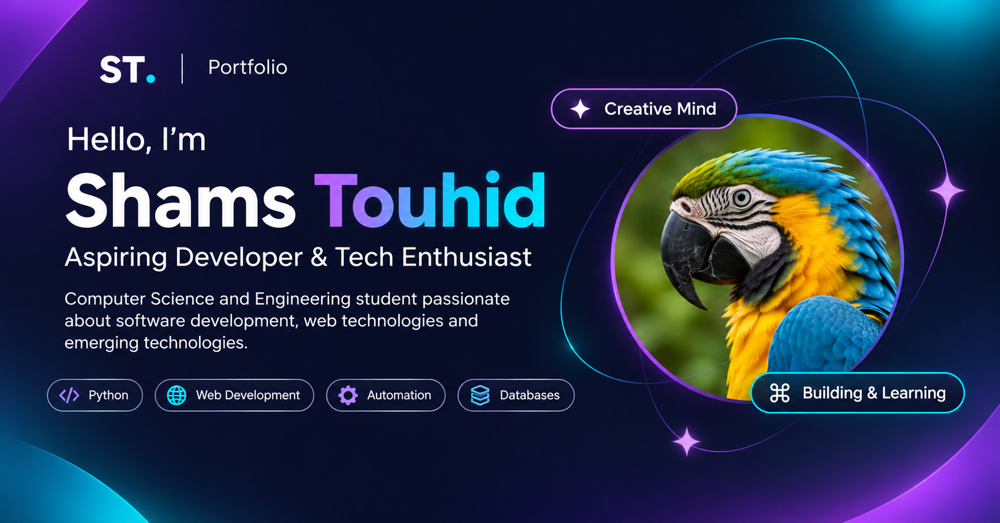

# 👨‍💻 Shams Touhid — Developer Portfolio

<p align="center">
  
</p>

<h3 align="center">
  Computer Science Student | Software Developer
</h3>

<p align="center">
  A personal portfolio showcasing my development journey, technical skills, and projects.
</p>

<p align="center">
  <a href="https://touhid971.github.io/shams-touhid-portfolio/">
    🌐 View Live Portfolio
  </a>
  •
  <a href="https://github.com/Touhid971">
    GitHub Profile
  </a>
</p>

---

## 📌 About The Project

This is my personal developer portfolio, built to showcase my technical skills, projects, and journey as a Computer Science Engineering student.

The website serves as my digital identity, providing visitors with an overview of my development interests and work.

## ✨ Highlights

- Personal developer introduction
- Technical skills showcase
- Project portfolio
- Responsive web design
- Personal branding and contact links

## 🛠️ Technologies Used

| Technology | Purpose |
|---|---|
| HTML5 | Website structure |
| CSS3 | Styling and layout |
| JavaScript | Interactive functionality |
| Git & GitHub | Version control and hosting |
| GitHub Pages | Website deployment |

## 📂 Project Structure

```text
shams-touhid-portfolio/
│
├── index.html
├── Style.css
├── portfolio-fixes.css
├── script.js
├── Social-preview.png
├── parrot.jpg
├── sitemap.xml
└── README.md
```

## 🚀 Getting Started

### Clone the repository

```bash
git clone https://github.com/Touhid971/shams-touhid-portfolio.git
```

### Open the project

```bash
cd shams-touhid-portfolio
```

Open `index.html` in your browser to explore the website locally.

## 🌐 Live Demo

**Visit:** https://touhid971.github.io/shams-touhid-portfolio/

## 📬 Connect With Me

- **GitHub:** https://github.com/Touhid971
- **LinkedIn:** https://www.linkedin.com/in/shams-touhid071/

---

<p align="center">
  <b>Designed and developed by Shams Touhid</b>
  <br>
  Building • Learning • Improving 🚀
</p>
